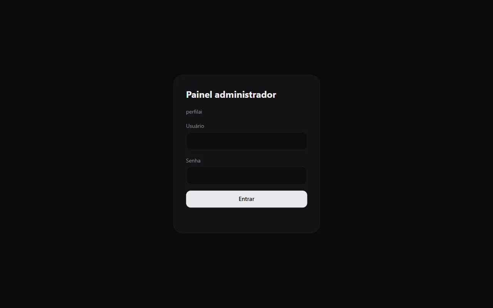

<!-- readme-padrao -->
# Perfilaí

> Perfilaí e suíte de perfil (insta-ai, face-ai, tittok-ai, linkdn-ai): plano de Instagram/redes com IA a partir do @, objetivo e prints (raio-x, bios, ideias, roteiros, carrosséis PNG, site de vendas). Use para mexer no Perfilaí ou nas marcas da suíte de perfil.


## O que é
Perfilaí e suíte de perfil (insta-ai, face-ai, tittok-ai, linkdn-ai): plano de Instagram/redes com IA a partir do @, objetivo e prints (raio-x, bios, ideias, roteiros, carrosséis PNG, site de vendas). Use para mexer no Perfilaí ou nas marcas da suíte de perfil.

Estado: **no ar**. Produto da Rangel Tech, vendido pela Cakto (conta do Lucas). Registro único dos produtos: `vps_rt_infra/registro/produtos.yml` (spec 57).

## Onde está no ar
- https://perfilai.rangeltech.net

Variantes que usam este mesmo código:
- **Insta AI**: https://insta-ai.rangeltech.net (mesmo código, outra "pele" por endereço; vendido como produto separado)
- **Face AI**: https://face-ai.rangeltech.net (mesmo código, outra "pele" por endereço; vendido como produto separado)
- **TikTok AI**: https://tittok-ai.rangeltech.net (mesmo código, outra "pele" por endereço; vendido como produto separado)
- **LinkedIn AI**: https://linkdn-ai.rangeltech.net (mesmo código, outra "pele" por endereço; vendido como produto separado)

**Painel do administrador:** `https://perfilai.rangeltech.net/admin` (login único dos produtos; a credencial está no Infisical, `rt-produtos/_admin`).



O usuário de teste (QA) de cada produto é obtido no painel único (`painel.rangeltech.net`, aba do produto).

## Onde faz o deploy
Este repositório **só publica** o artefato; **quem implanta é o `vps_rt_infra`** (nenhum container é trocado à mão).

1. Publicar a release: criar a tag (`v*`); o workflow `.github/workflows/release.yml` gera a imagem e o `release-manifest.json` e publica como release.
2. Implantar (de madrugada, 00h às 06h de Brasília): `gh workflow run deploy.yml --repo RangelTech/vps_rt_infra -f service=perfilai`
   - Só validar, sem implantar: acrescentar `-f dry_run=true`.
3. Voltar uma versão (rollback): `gh workflow run deploy.yml --repo RangelTech/vps_rt_infra -f service=perfilai -f version=<tag-antiga>`.

O serviço no mapa de releases é `perfilai` (`vps_rt_infra/releases/sources.json`).

## Como funciona por dentro
- **API e site:** FastAPI (Python) em `app/`, com a landing em `static/`. Container único (`Dockerfile`).
- **Dados:** hoje SQLite no volume do container; **está planejada a migração** para o banco `produtos` do Postgres (um schema por produto) e dos arquivos para o MinIO (spec 57, seções 8 e 8.6).
- **IA:** fala com o Qwen pelo `llm-access` (chave por produto).
- **Cobrança:** webhook da Cakto (`/api/cakto` ou rota equivalente) libera o plano; a conciliação diária compara pedidos e assinaturas.
- **Login:** hoje por código no e-mail; passa para e-mail e senha com captcha invisível e "entrar por link" (spec 57, seção 5A).

## Segredos
Só os **nomes** das variáveis estão neste repositório, em [`segredos.yml`](segredos.yml). Os **valores** ficam no Infisical (projeto `rt-produtos`, ambiente `prod`, pasta `perfilai`) e chegam à VPS **gerados no momento do deploy**. Nunca coloque valor de segredo no git.

## Rodar e testar localmente
```bash
python -m venv .venv && source .venv/bin/activate   # no Windows: .venv\Scripts\activate
pip install -r requirements.txt
pytest
```
Os testes de QA em produção são por cliques reais (relatório em PDF no `new_ragente/qa/evidencias`).

## Links
- Painel único: https://painel.rangeltech.net (aba do produto: links, usuário de QA, planos)
- Spec de organização geral: `new_ragente/specs/57_ORGANIZACAO_GERAL_PRODUTOS_E_PAINEL.md`
- Monitor: Uptime Kuma, `perfilai`

## Notas técnicas (README anterior)

# Perfilaí

Plano de Instagram com IA. A pessoa manda o @, o objetivo e prints do perfil; recebe raio-x, 3 bios, 30 ideias com gancho, 5 roteiros de Reels, stories de venda, 3 carrosséis em PNG e um site de vendas estático (.zip com passo a passo para GitHub Pages + Cakto).

- **Diretor:** `rt-planejar` (GPT) lê a leitura dos prints e decide estratégia, pauta e briefing.
- **Mão de obra:** `rt-geral` (Qwen) escreve bios, roteiros, stories, carrosséis e a página, seguindo o briefing.
- **Visão:** `visao` lê os prints do perfil. Não pedimos senha e não raspamos o Instagram (a leitura anônima é bloqueada).

Stack: FastAPI + SQLite (`/data`), front estático em `static/`, Pillow para os carrosséis. Login por código no e-mail; a conta de demonstração entra com senha. Assinatura pela Cakto (3 planos) com webhook em `/api/cakto`. Admin em `/api/admin/*` (cabeçalho `x-admin-key`).

```
python -m venv .venv && .venv/Scripts/pip install -r requirements-dev.txt
.venv/Scripts/python -m pytest -q
```

Release: workflow `release.yml` (imagem + manifesto). Deploy: somente pelo `vps_rt_infra` (`deploy.yml service=perfilai`). Spec: `new_ragente/specs/43_INSTAGRAM_IA.md`.
